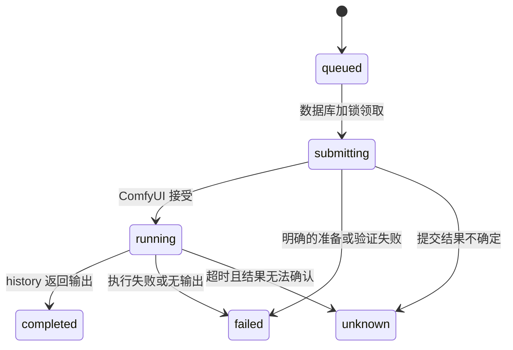

# 数据结构与交互约定

## 数据表

| 表 | 主键与关系 | 职责 |
| --- | --- | --- |
| `users` | UUID；`email` 唯一 | 登录邮箱、Argon2 密码哈希、创建时间。 |
| `uploads` | UUID；`user_id → users` | 用户上传素材的存储文件名、媒体类型和创建时间。文件保存在 API 与 worker 共享的上传目录。 |
| `tasks` | UUID；`user_id → users`；历史 `upload_id → uploads` | 当前任务类型、模型、提示词、参数、状态、0–100 的 ComfyUI 执行进度、prompt ID、错误、时间和旧版输出。用户、类型与时间的组合索引用于历史列表；状态与时间索引用于队列。 |
| `task_input_assets` | `(task_id, position)`；关联 `tasks`、`uploads` | 按顺序记录第一、第二张参考图及驱动视频；worker 优先读取该表。 |
| `task_outputs` | `(task_id, position)`；关联 `tasks` | ComfyUI 返回的文件名、目录、存储类型；任务结束与输出记录在同一数据库事务中写入。 |
| `task_events` | UUID；关联 `tasks`，按任务及时间索引 | 排队、提交、运行与结束等状态变更记录，不存储提示词。 |
| `task_workflow_snapshots` | `task_id → tasks` | 保存创建任务时已绑定提示词、参数和随机种子的工作流，以及素材节点映射；配置之后变化不会改变已排队任务。 |
| `task_requests` | UUID；`(user_id, request_key)` 唯一；关联 `tasks` | 提交幂等键与请求摘要；同一账号相同键和内容返回同一任务，不同内容返回 409。 |
| `schema_migrations` | 迁移版本 | 记录已完成的数据回填；迁移可重复运行。 |

`tasks.upload_id`、`tasks.options.second_upload_id`、`tasks.outputs` 仍保留并与新表双写，以兼容旧任务和旧版代码；当前输出读取仍依赖 `tasks.outputs`，不要手工只修改一边。迁移时回填旧输入、输出和一条“迁移前的当前状态”事件；旧任务无法恢复此前的状态轨迹或原始工作流快照，旧排队任务会按旧方式读取当前工作流配置。应用层校验素材归属；所有任务、素材和输出查询均按当前用户限制。

## 状态与任务提交

任务及输入、初始事件、请求标识和工作流快照在一个事务中创建。worker 使用 MySQL 8+ `FOR UPDATE SKIP LOCKED` 领取排队任务，转换状态时锁定任务并检查原状态，避免迟到的 worker 覆盖终态。状态、最终进度和输出在同一事务中更新；实时进度由 worker 在提交前连接 ComfyUI `/ws`，按匹配 prompt ID 的 `progress`、`executing`、`executed`、`execution_cached` 事件估算工作流节点进度并单调写入 MySQL，最终完成时置为 100%。运行中的任务仍通过 `/history/{prompt_id}` 确认结果，前端每 3 秒刷新任务列表；Redis 是可丢弃的短期缓存，MySQL 为权威来源。若 ComfyUI WebSocket 不可用，卡片保留已知状态和 0% 进度，不伪造进度；完成结果仍由 history 轮询确认。超时或提交结果不确定时不会重发 `/prompt`，避免重复生成；目前需要管理员按 `comfy_prompt_id` 在 ComfyUI 核对，尚无自动对账或重试界面。

前端先上传需要的素材，记录上传 ID，再以 `Idempotency-Key` 提交任务。页面停留期间相同输入重试会复用上传 ID 和请求键；刷新页面后表单和该键不会保留。任务列表按账号和图片/视频类型分页，并轮询当前可见页；生成成功后图片或视频通过带账户校验的站内地址访问。素材库只列出当前用户上传的图片。上传接口校验图片后计算原始文件字节的 SHA-256，按 `(user_id, sha256)` 唯一约束去重；重复上传返回已有素材 ID，并标记 `deduplicated: true`。并发上传由数据库唯一索引裁决，落选文件会删除。不同用户各自保存素材；内容相似但字节不同的图片不合并。已登记文件丢失时，相同内容再次上传会恢复该文件。历史迁移按用户和摘要合并记录，更新任务主图、第二张图及输入关联，提交后删除无引用的重复文件；缺失文件保留记录，不进行猜测合并。

## 升级与恢复

1. 停止 API 和所有 worker，等待正在提交的任务结束；不要在迁移时运行旧版服务。
2. 备份 MySQL 和整个上传目录，并验证备份可恢复。
3. 在 `backend` 运行 `python -m app.migrate`。脚本新增表、索引、字段并回填记录；素材去重迁移会合并重复记录并删除不再引用的重复文件，因此必须先备份上传目录；MySQL DDL 会隐式提交，所以脚本设计为可中断后重跑，并使用数据库锁避免同时迁移。
4. 核对已有任务与素材，再依次启动 API 和 worker。若升级失败，停止服务并从备份恢复，或修正问题后重新运行迁移。

当前实例升级前的备份位于 `backend/.local/backups/`，目录与备份仅供本机用户访问。未来字段或关系变更应新增有版本的迁移，不要修改已经执行的迁移逻辑。当前迁移并不是通用版本管理系统；上线前仍需建立受控发布流程、自动化恢复演练和更完整的迁移测试。

## 边界

模型可用性以服务端工作流注册表为准，页面只显示对应创作模式的模型。ComfyUI 端保存最终输出；如果其文件被清理，历史记录仍在但无法播放。没有对象存储、文件清理策略、邮件验证、密码重置、登录限流、会话撤销或多租户管理；JWT 登出只清除浏览器 cookie。公网部署前应补齐这些能力、使用 HTTPS 并保护 MySQL、Redis 和 ComfyUI。远端多服务实例、断点恢复和业务配额不在本版实现范围。
